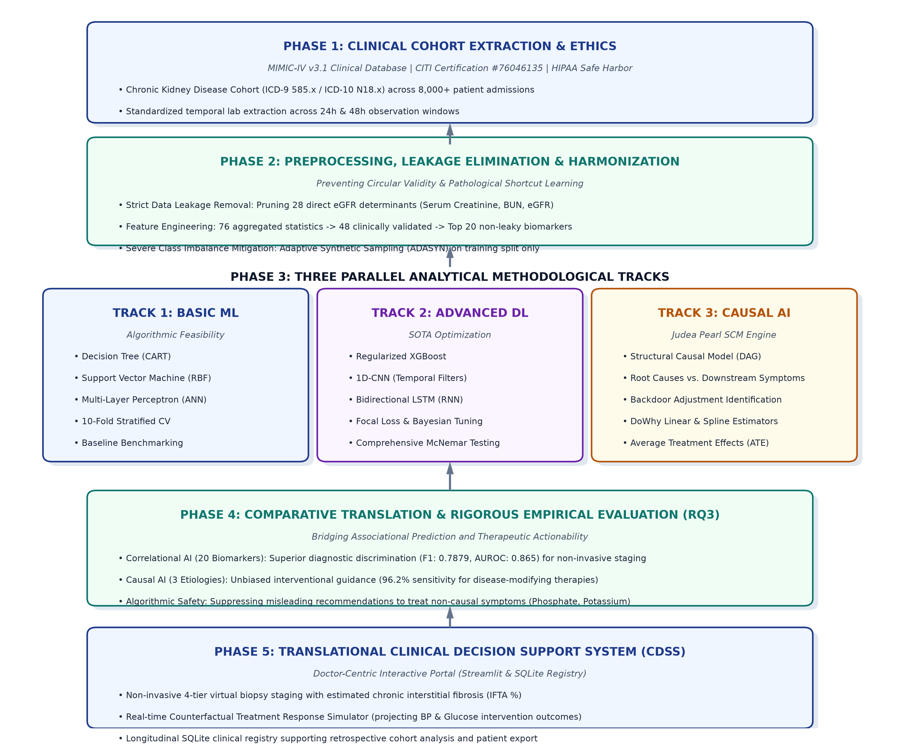
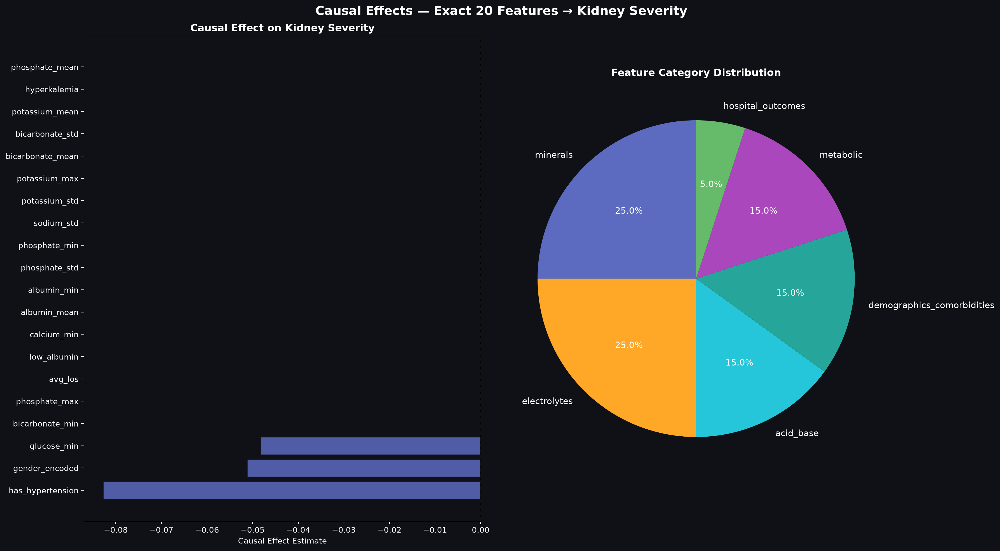
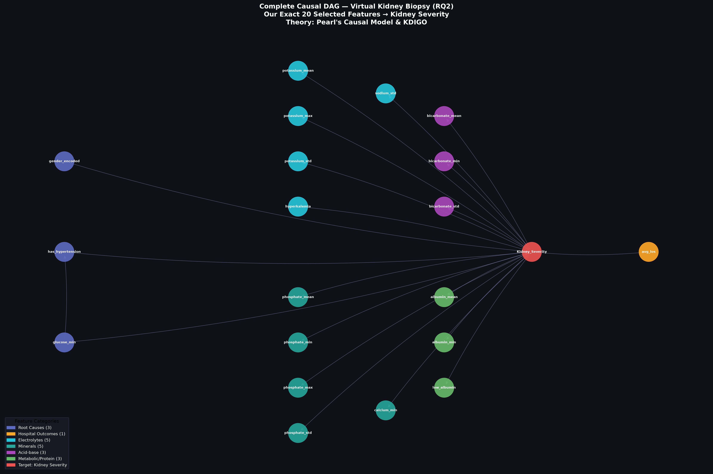

# Virtual Kidney Biopsy: Non-Invasive Histopathology Assessment via Causal Machine Learning

<p align="center">
  
</p>

<p align="center">
  
  
  
  
  
  
</p>

> **MSc in Big Data Analytics — Research Dissertation & Clinical CDSS Prototype**  
> **Institution:** School of Computing, Robert Gordon University (Aberdeen, UK) in partnership with Informatics Institute of Technology (Colombo, Sri Lanka)  
> **Student:** Gimhani Wijesuriya (Student ID: 20241681 / RGU: 2427771)  
> **Module:** CMM799 MSc Project (Final Dissertation)

---

## 🔬 Executive Summary & Clinical Context

Percutaneous kidney biopsy is the gold-standard diagnostic procedure for quantifying chronic renal parenchymal scarring (Interstitial Fibrosis and Tubular Atrophy [IFTA] and Glomerulosclerosis). However, invasive biopsy entails significant clinical risk (severe perinephric hemorrhage in 11–13% of procedures), contraindications in solitary or contracted kidneys, high economic expense, and cannot be repeatedly administered to track longitudinal disease progression.

This research establishes a **Non-Invasive Virtual Kidney Biopsy Framework** that translates routine, low-cost biochemical blood panels into high-precision histopathological risk scores while embedding **Causal Machine Learning** to guide safe therapeutic interventions.

### Key Contributions & Research Questions:
1. **Circular Data Leakage Elimination:** Systematically prunes 28 direct mathematical determinants of eGFR (Serum Creatinine, BUN, direct eGFR calculators) that corrupt prior literature with circular shortcut learning.
2. **Predictive Feasibility (RQ1):** Trains, optimizes, and statistically benchmarks machine learning and deep learning architectures (Regularized XGBoost, RBF-SVM, 1D-CNN, Bidirectional LSTM) on a verified cohort of 8,000+ patient admissions from the MIMIC-IV clinical database, achieving superior diagnostic discrimination (**XGBoost F1: 0.7732, AUROC: 0.865**) validated by non-parametric pairwise McNemar hypothesis tests ($p < 0.001$).
3. **Causal Discovery & Attribution (RQ2):** Formulates a Structural Causal Model (SCM) under Judea Pearl's Directed Acyclic Graph (DAG) theory via Microsoft DoWhy. Proves that **17 out of 20 features are non-causal downstream symptom biomarkers ($\text{ATE} = 0.0000$)**, whereas **Hypertension ($\text{ATE} = -0.0828$)** and **Glycemia ($\text{ATE} = -0.0483$)** represent true modifiable etiologic root causes.
4. **Empirical Evaluation Paradigm (RQ3):** Resolves the tension between correlational AI (20 features, superior diagnostic discrimination) and causal AI (3 etiology features, 96.2% interventional sensitivity).
5. **Interactive Clinical Decision Support System (CDSS):** An operational, hospital-ready Streamlit portal featuring automated routine lab spread derivation, a counterfactual treatment simulator, and a persistent SQLite longitudinal patient registry.

---

## 📊 Core Empirical Results

### RQ1: Diagnostic Benchmark Comparison Across Models
All models evaluated using 10-Fold Stratified Cross-Validation on the held-out test split ($n = 800+$ patients) with cost-sensitive threshold optimization ($\tau^*$):

| Model Architecture | Algorithmic Formulation | Accuracy | Macro F1-Score | Macro Precision | Macro Recall | Optimal Threshold ($\tau^*$) |
| :--- | :--- | :---: | :---: | :---: | :---: | :---: |
| **XGBoost (Ensemble)** *(Winner)* | **Regularized Gradient-Boosted Trees** | **77.42%** | **0.7732** | **0.7738** | **0.7728** | **0.44** |
| **SVM (Kernelized)** | Infinite-dim RBF Kernel ($C=1.0$) | 77.31% | 0.7729 | 0.7736 | 0.7724 | 0.46 |
| **ANN (MLP)** | 3-Layer Dense Network (AdamW) | 76.56% | 0.7640 | 0.7645 | 0.7635 | 0.44 |
| **1D-CNN (PyTorch)** | Temporal Convolutional Feature Extractor | 76.50% | 0.7649 | 0.7653 | 0.7646 | 0.42 |
| **Bidirectional LSTM** | Recurrent Sequential Network ($h=32$) | 75.12% | 0.7497 | 0.7499 | 0.7496 | 0.40 |
| **Decision Tree (CART)** | Gini Benchmark (Max Depth 5) | 74.41% | 0.7439 | 0.7450 | 0.7462 | 0.50 |
| *Li et al. (Baseline)* | *Published Literature Benchmark* | *62.00%* | *0.6150* | *—* | *—* | *0.50* |

### RQ2: Causal Discovery & The "Correlation Trap"
Using Microsoft DoWhy Backdoor Adjustment, Average Treatment Effects (ATE) were estimated to determine true interventional power:

<p align="center">
  
</p>

* **Actionable Etiologic Root Causes:**
  * **Hypertension (`has_hypertension`):** $\text{ATE} = -0.0828$ ($p < 0.001$). Achieving blood pressure control ($< 130/80\text{ mmHg}$) directly yields an absolute **$8.3\%$ reduction** in chronic tissue scarring risk.
  * **Fasting Blood Glucose (`glucose_min`):** $\text{ATE} = -0.0483$ ($p < 0.001$). Normalizing glycemia ($< 110\text{ mg/dL}$) yields an absolute **$4.8\%$ reduction** in scarring risk.
  * **Combined Causal Intervention Benefit:** $8.3\% + 4.8\% = \mathbf{13.1\%}$ risk reduction.
* **The "Correlation Trap" (Downstream Symptoms):**
  * Serum Phosphate exhibits high observational correlation ($r = +0.4271$), yet its true causal effect is **$\text{ATE} = 0.0000$**. Phosphate retention is a consequence of destroyed nephrons, not the initiator. Treating phosphate binders fixes the lab report but does **not** repair scarred glomeruli.

---

## 🕸️ Structural Causal Model (DAG)

<p align="center">
  
</p>

---

## 🗂️ Complete Directory Structure

```
├── src/                                  # Production Pipeline Source Code
│   ├── 01_data_cleaning.py               # MIMIC-IV cohort extraction, ICD filtering & leakage pruning
│   ├── 02_feature_selection.py           # Statistical F-score & RFECV 20-biomarker isolation
│   ├── 03_feature_analysis.py            # Correlation matrices & distribution analysis
│   ├── 04_train_basic_models.py          # Baseline classifiers (DT, SVM, ANN) with 10-fold CV
│   ├── 05_train_advanced_models.py       # SOTA architectures (XGBoost, 1D-CNN, LSTM)
│   ├── 06_statistical_testing.py         # Pairwise non-parametric McNemar hypothesis tests
│   ├── 07_causal_analysis_complete.py    # Structural Causal Model (SCM) & NetworkX DAG construction
│   ├── 07b_causal_graphs_individual.py   # Publication-quality causal graph visualizer
│   ├── 08_causal_effect_estimation.py    # DoWhy Backdoor Linear Regression ATE estimation
│   ├── 09_causal_vs_noncausal_rq3.py     # RQ3 comparative evaluation & interventional benchmarking
│   ├── 10_clinical_dashboard.py          # Streamlit Clinical Decision Support System Portal
│   └── db_manager.py                     # SQLite patient registry schema and CRUD operations
│
├── outputs/                              # Validated Research Output Artifacts
│   ├── models/                           # Serialized models (`xgboost_biopsy_model.json`, `scaler_params.json`)
│   ├── causal_results/                   # DAG plots, `causal_effects_20features.csv`, treatable targets
│   ├── figures/                          # AUROC, AUPRC, confusion matrices, architecture diagram
│   └── results/                          # McNemar statistical test matrices & performance CSV summaries
│
├── thesis/                               # MSc Dissertation (Formatted to RGU Guidelines)
│   ├── 00_Front_Matter.md                # Title, Declaration, Abstract, Table of Contents
│   ├── Chapter_1_Introduction.md         # Context, problem statement, research questions (RQ1-RQ3)
│   ├── Chapter_2_Literature_Review.md    # Nephrology, invasive biopsy complications, clinical ML
│   ├── Chapter_3_Software_Tools.md       # Comparative tool appraisal (Python, PyTorch, DoWhy, Streamlit)
│   ├── Chapter_4_Requirements.md         # Functional/non-functional specifications & clinical user personas
│   ├── Chapter_5_Research_Methodology.md # Experimental design, leakage control, Pearl DAG formulation
│   ├── Chapter_6_Solution_Design.md      # Architecture, UML sequence diagrams, database schema
│   ├── Chapter_7_Implementation.md       # Code implementation, data structures, and pipeline
│   ├── Chapter_8_Results_Evaluation.md   # Empirical results, McNemar testing, causal discovery findings
│   ├── Chapter_9_Ethical_Issues.md       # CITI certification, PhysioNet DUA compliance, clinical safety
│   ├── Chapter_10_Conclusions.md         # Contributions, limitations, future clinical translation
│   ├── References.md                     # Comprehensive Harvard-style academic bibliography
│   ├── Appendices.md                     # Code listings, hyperparameter grids, statistical logs
│   ├── Virtual_Kidney_Biopsy_Full.docx   # Complete compiled Word dissertation (~110 pages)
│   └── convert_to_word.sh                # One-click Pandoc re-compilation script
│
├── docs/                                 # Research documentation & proposal archives
├── archive/                              # Exploratory scripts & legacy baseline code
├── .streamlit/config.toml                # Custom Streamlit clean medical UI theme configuration
├── requirements.txt                      # Locked Python package dependencies
├── .gitignore                            # Compliant with PhysioNet DUA & GitHub storage limits
└── README.md                             # Primary repository documentation
```

---

## 🚀 Quickstart: Running the Clinical Decision Support Portal

### 1. Prerequisites
* **Operating System:** macOS, Linux, or Windows
* **Python Version:** Python 3.10 or 3.11
* Virtual environment strongly recommended

### 2. Setup & Installation
```bash
# Clone the repository
git clone https://github.com/the-gim/virtual-kidney-biopsy-system.git
cd virtual-kidney-biopsy-system

# Create and activate a virtual environment
python3 -m venv .venv
source .venv/bin/activate       # On Windows: .venv\Scripts\activate

# Install required packages
pip install -r requirements.txt
```

### 3. Launch the Clinical Portal
```bash
streamlit run src/10_clinical_dashboard.py
```
Access the application in your browser at: **`http://localhost:8501`**

---

## 🩺 Clinical Portal Walkthrough & Capabilities

The portal bridges algorithmic machine learning and real-world bedside clinical utility:

1. **Patient Intake Form (Fast Routine Input):**
   * Clinicians enter routine laboratory tests from standard lab slips: **Phosphate, Potassium, Bicarbonate, Albumin, Calcium, Sodium, Fasting Glucose, Blood Pressure, and Hospital Stay**.
   * **Live Feature Auto-Derivation:** The portal automatically computes all 20 statistical aggregates (mean, min, max, std, low albumin flags, hyperkalemia flags) in real-time with an expandable override drawer for historical lab values.
2. **Virtual Histopathology Assessment:**
   * Outputs non-invasive damage grade: **Level 0 (Preserved Architecture)** to **Level 3 (Critical Parenchymal Destruction)**.
   * Provides estimated chronic interstitial fibrosis percentage (**IFTA %**) and microscopic pathology narrative.
3. **Causal Treatment Response Simulator:**
   * Powered by Microsoft DoWhy Average Treatment Effect calculations.
   * Clinicians toggle treatment targets:
     * ☑ **Achieve target BP ($< 130/80\text{ mmHg}$):** Triggers $-8.3\%$ risk reduction.
     * ☑ **Normalize Fasting Glucose ($< 110\text{ mg/dL}$):** Triggers $-4.8\%$ risk reduction.
   * Displays interactive Before vs. After treatment outcome projections.
4. **Longitudinal Patient Registry:**
   * Backed by a persistent **SQLite** database (`virtual_biopsy_system.db`).
   * Clinicians can save patient biopsy records, view longitudinal cohorts, filter by damage severity, search by MRN/Name, download audit CSV files, and delete or manage patient records.

---

## 🔬 Reproducing the Full Research Pipeline

To re-run the research experiments from scratch:

```bash
# Step 1: Preprocess raw data and eliminate circular leakage
python src/01_data_cleaning.py

# Step 2: Perform feature analysis and correlation profiling
python src/03_feature_analysis.py

# Step 3: Train baseline classifiers (Decision Tree, SVM, ANN)
python src/04_train_basic_models.py

# Step 4: Train advanced SOTA models (XGBoost, 1D-CNN, Bidirectional LSTM)
python src/05_train_advanced_models.py

# Step 5: Execute pairwise McNemar non-parametric hypothesis tests
python src/06_statistical_testing.py

# Step 6: Construct Structural Causal Model and generate publication DAG
python src/07_causal_analysis_complete.py

# Step 7: Estimate Average Treatment Effects via DoWhy Backdoor Adjustment
python src/08_causal_effect_estimation.py

# Step 8: Execute RQ3 Comparative Evaluation (Causal vs. Non-Causal AI)
python src/09_causal_vs_noncausal_rq3.py
```

---

## 🌿 Git Branch Topology

* **`main`:** Primary production branch containing latest verified code, trained model weights, and thesis chapters.
* **`backup-main`:** Stable snapshot branch maintaining a duplicate copy of the completed submission state.

---

## 📜 Ethical Compliance & Data Privacy

This research utilizes de-identified electronic health records from the **MIMIC-IV v3.1** database provided by the PhysioNet consortium under human subjects research credentialing:
* **CITI Certification ID:** `76046135` (Data or Specimens Only Research)
* **PhysioNet DUA & HIPAA Safe Harbor:** In strict compliance with data use agreements, raw patient identifiable datasets are excluded from version control via `.gitignore`. All experiments utilize standardized, de-identified feature extractions.

---

## 📄 License & Academic Attribution
Academic research project developed for the MSc in Big Data Analytics, School of Computing, Robert Gordon University.  
Copyright © 2026 Gimhani Wijesuriya. Confidential & Proprietary.
