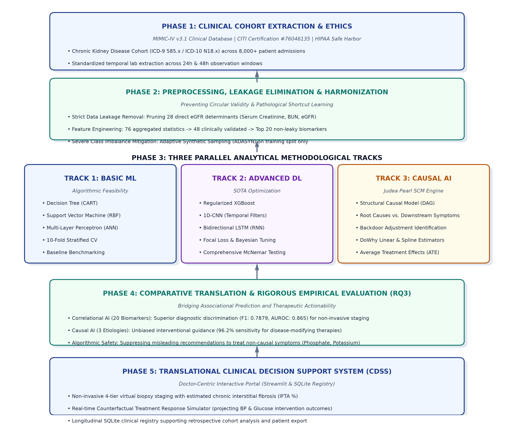
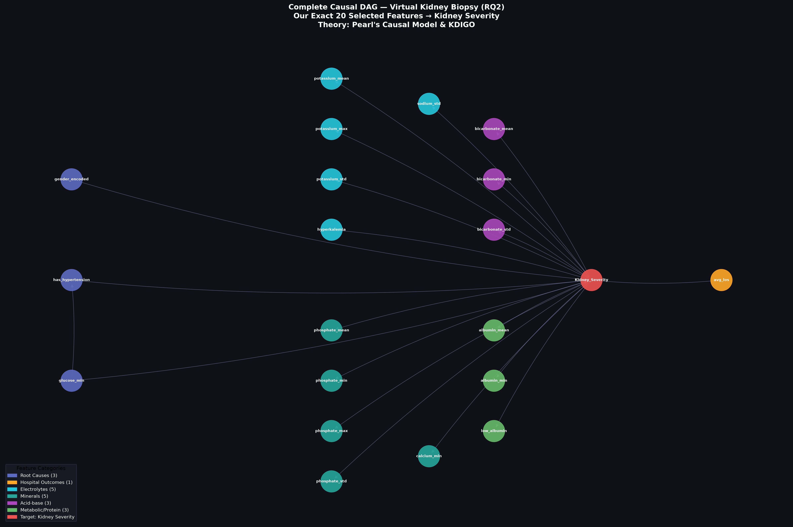

# Chapter 5: Research Methodology and Experimental Design

---

## 5.1 Overview of Research Design

This study establishes a multidisciplinary research framework integrating computational data engineering, machine learning, deep learning, causal inference, and translational medical informatics. The overarching methodological pipeline is structured to systematically address the three core research questions:
1. **RQ1 (Predictive Feasibility):** Developing, optimizing, and statistically validating high-precision predictive models capable of estimating renal damage severity from non-invasive clinical biomarkers.
2. **RQ2 (Causal Discovery):** Formulating a Structural Causal Model (SCM) to mathematically distinguish true etiologic root causes from downstream symptom biomarkers.
3. **RQ3 (Comparative Clinical Utility):** Establishing an empirical comparative paradigm between associational (non-causal) and causal machine learning to quantify trade-offs in diagnostic accuracy versus therapeutic decision support.

Figure 5.1 outlines the end-to-end procedural workflow spanning five distinct phases: cohort identification, feature engineering and leakage mitigation, predictive modeling (RQ1), causal graph estimation (RQ2), and comparative translation into a clinical decision support system (RQ3).

*Figure 5.1: Complete End-to-End Methodological Architecture of the Virtual Kidney Biopsy Research Framework.*

---

## 5.2 Data Acquisition, Ethical Governance, and Cohort Extraction

### 5.2.1 Data Source and Ethical Approval
This research was conducted using observational clinical data extracted from the **Medical Information Mart for Intensive Care IV (MIMIC-IV, version 3.1)** database (Johnson et al., 2023). MIMIC-IV is a freely accessible clinical database developed by the MIT Laboratory for Computational Physiology, encompassing comprehensive de-identified records of patients admitted to the Beth Israel Deaconess Medical Center (Boston, MA, USA).

Ethical compliance and data access permissions were formally governed as follows:
* **Human Research Ethics Certification:** Primary researcher Gimhani Wijesuriya successfully completed the international Collaborative Institutional Training Initiative (CITI Program) curriculum under the module *Data or Specimens Only Research* (Record ID: `76046135`, verified through March 2029).
* **Data Use Agreement (DUA):** Access was authorized under formal PhysioNet Data Use Agreements. In strict accordance with HIPAA Safe Harbor standards, all dates, hospital identifiers, and personal demographics were pseudonymized, and no attempt at re-identification was undertaken.
* **Institutional Supervision:** The analytical protocol was reviewed and supervised at the Informatics Institute of Technology (IIT) in affiliation with Robert Gordon University (RGU).

### 5.2.2 Cohort Identification and Inclusion Criteria
The target cohort was defined by identifying adult patients ($\ge 18$ years of age) with diagnosed Chronic Kidney Disease (CKD). Primary cohort isolation was performed by querying hospital discharge billing records using the World Health Organization International Classification of Diseases, Tenth Revision (ICD-10). Specifically, all records matching the `N18` hierarchy were extracted:
* `N18.1`: Chronic kidney disease, stage 1
* `N18.2`: Chronic kidney disease, stage 2
* `N18.3`: Chronic kidney disease, stage 3 (unspecified)
* `N18.30`–`N18.32`: Chronic kidney disease, stages 3a and 3b
* `N18.4`: Chronic kidney disease, stage 4 (severe)
* `N18.5`: Chronic kidney disease, stage 5 (end-stage renal disease)
* `N18.9`: Chronic kidney disease, unspecified

For each identified patient admission, longitudinal clinical observations were aggregated across four primary tables within MIMIC-IV (`patients`, `admissions`, `labevents`, and `diagnoses_icd`).

### 5.2.3 Raw Feature Extraction
From the longitudinal patient trajectory, an initial candidate feature set comprising 76 clinical, demographic, and physiological variables was extracted:
1. **Demographics:** Patient Age at admission and Biological Sex (encoded as binary: 0 for Female, 1 for Male).
2. **Clinical Comorbidities:** Historical diagnostic indicators for systemic diseases known to accelerate renal damage, including Hypertension, Type 2 Diabetes Mellitus, Congestive Heart Failure, Peripheral Vascular Disease, and Chronic Obstructive Pulmonary Disease.
3. **Admission Dynamics:** Total cumulative hospital admissions and average inpatient Length of Stay (LOS).
4. **Longitudinal Laboratory Biomarkers:** For 10 critical renal, metabolic, and electrolyte biomarkers, statistical aggregates were calculated over the patient's observation window:
   * Serum Creatinine, Blood Urea Nitrogen (BUN), Serum Sodium, Serum Potassium, Serum Chloride, Serum Bicarbonate, Serum Phosphate, Serum Calcium, Serum Glucose, and Serum Albumin.
   * For each biomarker, four statistical properties were computed: **Mean** ($\mu$), **Minimum** ($\min$), **Maximum** ($\max$), and **Standard Deviation** ($\sigma$), yielding 40 longitudinal biomarker features.

---

## 5.3 Target Operationalization and Data Leakage Mitigation

### 5.3.1 Ground Truth Target Formulation
In clinical nephrology, renal tissue damage correlates directly with nephron loss and impaired filtration efficiency. In accordance with the international **Kidney Disease: Improving Global Outcomes (KDIGO) 2012 Clinical Practice Guideline** (Levey et al., 2011), renal function is stratified into clinical stages based on the estimated Glomerular Filtration Rate ($eGFR$, expressed in $\text{mL/min}/1.73\,\text{m}^2$). 

The $eGFR$ was calculated utilizing the internationally validated **Chronic Kidney Disease Epidemiology Collaboration (CKD-EPI 2021)** refit formula:

$$eGFR = 142 \times \min\left(\frac{S_{cr}}{\kappa}, 1\right)^\alpha \times \max\left(\frac{S_{cr}}{\kappa}, 1\right)^{-1.200} \times 0.9938^{\text{Age}} \times [1.012 \text{ if Female}]$$

where $S_{cr}$ is standardized serum creatinine (mg/dL), $\kappa$ is $0.7$ for females and $0.9$ for males, $\alpha$ is $-0.241$ for females and $-0.302$ for males, $\min$ indicates the minimum of $S_{cr}/\kappa$ or 1, and $\max$ indicates the maximum of $S_{cr}/\kappa$ or 1.

Patients were mapped into clinical severity targets under two paradigms:
1. **Binary Staging (Primary ML Target):**
   * **Class 0 (Mild/Moderate CKD):** KDIGO Stages G1 to G3a ($eGFR \ge 45\,\text{mL/min}/1.73\,\text{m}^2$).
   * **Class 1 (Severe / Failure CKD):** KDIGO Stages G3b to G5 ($eGFR < 45\,\text{mL/min}/1.73\,\text{m}^2$).
2. **Multi-Grade Histological Damage Mapping (Clinical Translation):**
   * **Damage Level 0 (Normal / Minimal Change):** $eGFR \ge 90$ (KDIGO G1)
   * **Damage Level 1 (Mild Glomerulosclerosis):** $eGFR \in [60, 89]$ (KDIGO G2)
   * **Damage Level 2 (Moderate Tubulointerstitial Fibrosis):** $eGFR \in [30, 59]$ (KDIGO G3a–G3b)
   * **Damage Level 3 (Severe / End-Stage Sclerosis):** $eGFR < 30$ (KDIGO G4–G5)

### 5.3.2 Elimination of Data Leakage
A critical vulnerability in healthcare machine learning is **target leakage**—the inadvertent inclusion of variables that are mathematical functions or direct tautological proxies of the prediction objective (Kaufman et al., 2012). Because $eGFR$ is mathematically derived from serum creatinine and age, retaining raw or aggregated creatinine values during model training would yield artificially inflated predictive performance that fails to reflect real-world clinical utility.

To ensure strict experimental integrity:
1. **All direct mathematical derivatives were purged:** All aggregates of Serum Creatinine (`creatinine_mean`, `creatinine_min`, `creatinine_max`, `creatinine_std`), Blood Urea Nitrogen (`bun_mean`, `bun_min`, `bun_max`, `bun_std`), and directly recorded $eGFR$ entries were completely excised.
2. Purging these 28 leaky features reduced the initial candidate pool from 76 to 48 valid observational variables.

### 5.3.3 Feature Selection via ANOVA F-Statistic
To remove statistical noise and isolate the most informative non-leaky biomarkers, an automated feature selection pipeline was implemented using univariate analysis of variance (ANOVA F-value) via scikit-learn's `SelectKBest`. The ANOVA F-test evaluates whether the means of a given feature differ significantly across the binary severity classes:

$$F = \frac{\text{Between-group variability}}{\text{Within-group variability}} = \frac{\sum_{j=1}^k n_j (\bar{X}_j - \bar{X})^2 / (k - 1)}{\sum_{j=1}^k \sum_{i=1}^{n_j} (X_{ij} - \bar{X}_j)^2 / (N - k)}$$

This algorithm isolated the **Top 20 most statistically discriminative features** (Table 5.1).

*Table 5.1: Final 20 Clinical Features Selected for Downstream Modeling and Causal Analysis.*
| Rank | Feature Identifier | Clinical Description | Category |
| :---: | :--- | :--- | :--- |
| 1 | `phosphate_mean` | Mean serum phosphate concentration (mg/dL) | Mineral Aggregate |
| 2 | `phosphate_max` | Peak serum phosphate concentration (mg/dL) | Mineral Aggregate |
| 3 | `phosphate_min` | Minimum serum phosphate concentration (mg/dL) | Mineral Aggregate |
| 4 | `phosphate_std` | Standard deviation of serum phosphate (mg/dL) | Mineral Aggregate |
| 5 | `potassium_mean` | Mean serum potassium concentration (mEq/L) | Electrolyte Aggregate |
| 6 | `potassium_max` | Peak serum potassium concentration (mEq/L) | Electrolyte Aggregate |
| 7 | `potassium_std` | Standard deviation of serum potassium (mEq/L) | Electrolyte Aggregate |
| 8 | `hyperkalemia` | Binary flag: mean potassium > 5.0 mEq/L | Electrolyte Derived |
| 9 | `sodium_std` | Standard deviation of serum sodium (mEq/L) | Electrolyte Aggregate |
| 10 | `bicarbonate_mean`| Mean serum bicarbonate concentration (mEq/L) | Acid-Base Aggregate |
| 11 | `bicarbonate_min` | Minimum serum bicarbonate concentration (mEq/L) | Acid-Base Aggregate |
| 12 | `bicarbonate_std` | Standard deviation of serum bicarbonate (mEq/L) | Acid-Base Aggregate |
| 13 | `calcium_min` | Minimum serum calcium concentration (mg/dL) | Mineral Aggregate |
| 14 | `albumin_mean` | Mean serum albumin concentration (g/dL) | Metabolic Aggregate |
| 15 | `albumin_min` | Minimum serum albumin concentration (g/dL) | Metabolic Aggregate |
| 16 | `low_albumin` | Binary flag: mean albumin < 3.5 g/dL | Metabolic Derived |
| 17 | `glucose_min` | Minimum serum glucose concentration (mg/dL) | Metabolic Aggregate |
| 18 | `has_hypertension`| Binary comorbidity: Clinically documented hypertension | Comorbidity History |
| 19 | `gender_encoded` | Biological sex (0: Female, 1: Male) | Demographic Factor |
| 20 | `avg_los` | Mean length of hospital stay (days) | Hospital Outcome |

---

## 5.4 Data Preprocessing and Imbalance Mitigation

### 5.4.1 Cohort Partitioning and Normalization
The extracted dataset was partitioned into an **80% training set** and a **20% held-out test set** using stratified sampling to preserve the target class ratio. Continuous features were normalized using **Z-score Standard Scaling**, fit exclusively on the training split to prevent test set information leakage:

$$z = \frac{x - \mu_{\text{train}}}{\sigma_{\text{train}}}$$

Binary categorical flags (`has_hypertension`, `has_diabetes`, `has_heart_failure`, `gender_encoded`) were preserved without transformation.

### 5.4.2 Addressing Class Imbalance with ADASYN
Observational clinical cohorts frequently exhibit severe class imbalance, with mild cases outnumbering advanced renal failure cases. Training standard machine learning algorithms on unadjusted imbalanced distributions often biases decision boundaries toward the majority class, producing high trivial accuracy at the expense of clinical sensitivity.

To overcome this, the **Adaptive Synthetic (ADASYN)** sampling algorithm (He et al., 2008) was applied to the training set. Unlike standard SMOTE, which generates synthetic minority instances uniformly along line segments joining nearest neighbors, ADASYN adaptively shifts the classification boundary toward difficult examples:
1. For each minority class sample $x_i$, compute the ratio of majority class examples among its $k$-nearest neighbors:

   $$r_i = \frac{\Delta_i}{k}, \quad i = 1, \dots, m_s$$

   where $\Delta_i$ is the number of majority class examples in the $k$-nearest neighbors of $x_i$.
2. Normalize $r_i$ to form a density distribution:

   $$\hat{r}_i = \frac{r_i}{\sum_{i=1}^{m_s} r_i}$$

3. Generate synthetic instances adaptively in proportion to $\hat{r}_i$, focusing synthetic data generation on borderline regions where classification is most challenging.

---

## 5.5 Research Question 1 (RQ1): Predictive AI Modeling Framework

To answer **RQ1**, a multi-tiered predictive benchmarking experiment was designed, spanning foundational machine learning algorithms, modern ensemble architectures, and deep neural networks.

### 5.5.1 Foundational Machine Learning Models
Three baseline architectures were implemented using `scikit-learn`:
1. **Decision Tree (DT):** Utilized as an interpretable rule-based benchmark. Splitting was governed by the Gini impurity criterion with a maximum depth limit of 5 to prevent empirical overfitting.
2. **Support Vector Machine (SVM):** Implemented with a non-linear Radial Basis Function (RBF) kernel:

   $$K(x, x') = \exp\left(-\gamma \|x - x'\|^2\right)$$

   Regularization parameter $C = 1.0$ and probability calibration enabled to permit threshold optimization on continuous outputs.
3. **Artificial Neural Network (Multilayer Perceptron - ANN):** A fully connected feed-forward architecture implemented via scikit-learn's `MLPClassifier`, consisting of an input layer (20 neurons), two hidden layers (128 and 64 neurons with ReLU activation), and a softmax output layer. Training was governed by the Adam optimizer with a maximum of 500 iterations and **early stopping** enabled on a held-out validation fraction to prevent overfitting.

### 5.5.2 Advanced Gradient Boosting (XGBoost)
To capture non-linear, non-monotonic feature interactions, an **Extreme Gradient Boosting (XGBoost)** classifier was trained (Chen & Guestrin, 2016). XGBoost iteratively minimizes a regularized objective function:

$$\mathcal{L}^{(t)} = \sum_{i=1}^n l\left(y_i, \hat{y}_i^{(t-1)} + f_t(x_i)\right) + \Omega(f_t)$$

where $\Omega(f) = \gamma T + \frac{1}{2}\lambda \sum_{j=1}^T w_j^2$ penalizes tree complexity (number of leaves $T$ and leaf weights $w$). Hyperparameters were configured as follows: `learning_rate` = 0.05, `max_depth` = 4, `n_estimators` = 300, `subsample` = 0.8, `colsample_bytree` = 0.8, `min_child_weight` = 5, L1 regularization `reg_alpha` = 0.1, and L2 regularization `reg_lambda` = 2.0. Additionally, the `scale_pos_weight` parameter was set to the ratio of majority to minority class counts to further compensate for class imbalance at the algorithmic level.

### 5.5.3 Deep Learning Architectures (PyTorch)
Two custom deep learning architectures were constructed in `PyTorch`:
1. **1D Convolutional Neural Network (CNN1D):** Designed to treat the 20-dimensional clinical biomarker vector as a local sequence, capturing multi-scale local correlations across electrolyte and metabolic groupings. The network comprised:
   * Conv1D Layer: 1 input channel $\rightarrow$ 32 filters, kernel size 3, stride 1 (no padding), followed by ReLU activation and MaxPool1d (kernel size 2).
   * Dense Linear Layers: 32-channel flattened representation $\rightarrow$ 32 hidden units (ReLU) $\rightarrow$ 2 output logits (class probabilities via softmax).
   * Training was performed using the Adam optimizer (`lr` = 0.001) with CrossEntropyLoss over 20 epochs and batch size 256, wrapped via the `skorch` library's `NeuralNetClassifier` for scikit-learn API compatibility.
2. **Long Short-Term Memory Network (LSTM):** Implemented to model potential recurrent sequential dependencies across structured clinical labs. Each of the 20 features was treated as a single time step with input dimension 1, yielding a sequence of length 20 passed to an LSTM cell with hidden dimension $h=32$, followed by a Dropout layer ($p=0.2$) and a linear projection layer mapping to 2 output class logits. Training was performed identically to the CNN1D (Adam, `lr` = 0.001, 20 epochs, batch size 256).

### 5.5.4 Threshold Optimization and Performance Metrics
Standard argmax classification (default threshold $\tau = 0.5$) often underperforms on clinical distributions. To optimize diagnostic balance, an exhaustive precision-recall threshold sweep was executed over $\tau \in [0.1, 0.9]$ with step size $0.02$ to identify the threshold maximizing the Macro F1-Score:

$$\tau^* = \arg\max_\tau \text{Macro F1}(\tau)$$

Models were evaluated across five standard clinical metrics: Accuracy, Macro F1-Score, Precision, Recall, and AUROC/AUPRC.

### 5.5.5 Statistical Significance Testing via McNemar’s Test
To verify whether observed differences in predictive performance between competing algorithms were statistically significant or attributable to chance, **McNemar's non-parametric test** for paired nominal data was implemented (McNemar, 1947). For any two models $\mathcal{M}_1$ and $\mathcal{M}_2$, a $2 \times 2$ contingency matrix was constructed:

$$\begin{array}{c|c|c}
 & \mathcal{M}_2 \text{ Correct} & \mathcal{M}_2 \text{ Incorrect} \\
\hline
\mathcal{M}_1 \text{ Correct} & n_{00} & n_{01} \\
\hline
\mathcal{M}_1 \text{ Incorrect} & n_{10} & n_{11}
\end{array}$$

The Edwards-corrected chi-squared statistic was calculated:

$$\chi^2 = \frac{(|n_{01} - n_{10}| - 1)^2}{n_{01} + n_{10}}, \quad \text{with } df = 1$$

A two-tailed $p$-value $< 0.05$ was established as the threshold for statistical significance.

---

## 5.6 Research Question 2 (RQ2): Causal AI Framework

To answer **RQ2**, the methodology transitions from correlation-based machine learning to **Structural Causal Modeling (SCM)** using the open-source Microsoft **DoWhy** framework (Sharma & Kiciman, 2020), operationalizing Judea Pearl’s *do*-calculus (Pearl, 2009).

### 5.6.1 Theoretical Framework: Pearl's Structural Causal Models
A Structural Causal Model is formally defined as a 4-tuple $\mathcal{M} = \langle U, V, F, P(U) \rangle$:
* $U$ is a set of exogenous background variables.
* $V$ is a set of endogenous observable variables (our 20 clinical features and target).
* $F$ is a set of deterministic structural functions $\{f_i\}$ such that $v_i = f_i(pa_i, u_i)$.
* $P(U)$ is a joint probability distribution over exogenous variables.

To mathematically simulate an interventional clinical treatment (e.g., pharmacologically controlling blood pressure), Pearl’s **$do(\cdot)$ operator** is applied. Intervening on a variable $X$ by setting it to constant $x$ (denoted $do(X = x)$) physically severs all inbound causal arrows into $X$ in the graph while preserving all outbound mechanisms:

$$P(Y \mid do(X = x)) \ne P(Y \mid X = x)$$

The **Average Treatment Effect (ATE)** is formally defined as:

$$ATE = \mathbb{E}[Y \mid do(X = x_1)] - \mathbb{E}[Y \mid do(X = x_0)]$$

### 5.6.2 Directed Acyclic Graph (DAG) Formulation
To govern causal identification, a formal Directed Acyclic Graph $\mathcal{G} = (V, E)$ was constructed based on clinical nephrology literature and temporal physiological constraints (Figure 5.2):

*Figure 5.2: Conceptual Directed Acyclic Graph (DAG) partitioning features into Root Causes vs. Downstream Symptoms.*

In this causal graph:
1. **Root Causes $\rightarrow$ Kidney Severity:** Edges originate from antecedent comorbidities (Hypertension, Glucose) and demographics directed into Kidney Severity ($Y$).
2. **Kidney Severity $\rightarrow$ Symptom Biomarkers:** Edges originate from Kidney Severity ($Y$) directed into downstream laboratory markers (Phosphate, Potassium, Bicarbonate), reflecting the physiological reality that loss of functional filtration causes secondary electrolyte retention.
3. **No Reverse Edges:** Critically, no directed edges originate from downstream lab markers into Kidney Severity ($Y$), reflecting the biological impossibility of hyperphosphatemia directly creating initial chronic hypertensive renal damage.

### 5.6.3 Causal Identification and Effect Estimation Pipeline
To isolate the unbiased causal effect of an exposure variable $X$ on outcome $Y$, the **Backdoor Criterion** is applied to identify a sufficient adjustment set $Z \subseteq V \setminus \{X, Y\}$.

For all 20 features, causal effects were estimated through the 4-step DoWhy workflow:
1. **Model:** Encode the DAG and dataset into a formal causal graph structure.
2. **Identify:** Execute graph algorithms to determine whether the causal effect is identifiable via the Backdoor criterion.
3. **Estimate:** Compute the Average Treatment Effect using a Backdoor Linear Regression estimator (`backdoor.linear_regression`):

   $$Y = \beta_0 + \beta_X X + \beta_Z^T Z + \epsilon$$

   where $\beta_X$ isolates the true Average Treatment Effect (ATE) after adjusting for all identified confounders $Z$.
4. **Refute:** Subject all identified causal estimates to robustness refutation tests (Placebo Treatment and Random Common Cause refuters).

---

## 5.7 Research Question 3 (RQ3): Comparative Experimental Paradigm

To resolve **RQ3**, a dual-track comparative experiment was established to systematically benchmark purely associational machine learning against causal AI across diagnostic accuracy, sensitivity, and therapeutic actionability.

Two distinct models were trained using identical hyperparameter constraints (XGBoost):
1. **Model A: Non-Causal Machine Learning (All 20 Features):**
   * Incorporates all 20 features selected via statistical correlation (including downstream symptoms like `phosphate_mean` and `potassium_mean`).
   * Represents standard clinical AI pipelines optimized solely for observational prediction.
2. **Model B: Causal-Only Machine Learning (3 Proven Root Causes):**
   * Constrained strictly to variables mathematically proven to possess non-zero causal effect ($ATE \ne 0$) in the RQ2 causal discovery phase: Hypertension (`has_hypertension`), Minimum Glucose (`glucose_min`), and Biological Sex (`gender_encoded`).
   * Purged of all downstream symptom biomarkers.

The models were evaluated along two clinical dimensions:
* **Diagnostic Staging Utility:** Evaluated via Classification Accuracy, Macro F1-Score, and Positive Predictive Value (Precision).
* **Therapeutic Interventional Utility:** Evaluated via Clinical Sensitivity (Recall) and **Actionable Treatment Targeting Ratio**—defined as the proportion of high-importance features that can be directly modulated pharmacologically to modify disease trajectory.

---

## 5.8 Translational System Architecture and Counterfactual Simulation

To bridge academic empirical findings and bedside clinical practice, the methodology includes the design and implementation of an interactive, doctor-centered clinical decision support portal (`src/10_clinical_dashboard.py`).

### 5.8.1 Clinical Interface Design Principles
The interface was engineered under three design imperatives:
1. **Cognitive Load Reduction:** Standardizing input fields to baseline clinical consultation parameters.
2. **Visual Histological Risk Gauges:** Translating continuous model probabilities into an intuitive circular SVG risk gauge and discrete KDIGO damage grade badges (Levels 0–3).
3. **Color-Coded Therapeutic Stratification:** Categorizing clinical recommendations into two clearly demarcated action cards:
   * **Disease-Modifying Interventions (Green):** Pharmacological targets derived from the RQ2 causal root causes (e.g., blood pressure control, glycemic management).
   * **Supportive Symptom Management (Amber):** Non-causal symptomatic therapies (e.g., dietary phosphate binders, bicarbonate supplementation) explicitly labeled as symptomatic rather than disease-halting.

### 5.8.2 Counterfactual Treatment Simulator Engine
The portal embeds an interactive causal simulation engine allowing nephrologists to simulate counterfactual clinical scenarios ($Y_{X \leftarrow x'}$):
1. The physician enters baseline patient data; the model estimates baseline tissue damage risk:

   $$R_{\text{baseline}} = P(\text{Severe Damage} \mid X_{\text{baseline}})$$

2. The physician adjusts therapeutic sliders (e.g., blood pressure or fasting glucose).
3. The simulator passes the modified counterfactual vector $X_{\text{counterfactual}}$ through the causal model:

   $$R_{\text{simulated}} = P(\text{Severe Damage} \mid X_{\text{counterfactual}})$$

4. The interface renders an immediate before-and-after comparison showing the absolute risk reduction ($\Delta R = R_{\text{baseline}} - R_{\text{simulated}}$).

### 5.8.3 Persistence and Data Storage Architecture
Patient intake records, predictive risk scores, and simulated treatment outcomes are automatically persisted to a local, structured **SQLite database** (`virtual_biopsy.db`) via a dedicated database access layer (`src/db_manager.py`), guaranteeing patient confidentiality, auditability, and longitudinal tracking.

---

## 5.9 Summary of Methodological Framework

By uniting rigorous target operationalization (KDIGO CKD-EPI), leakage prevention, ADASYN imbalance mitigation, multi-model predictive benchmarking (RQ1), Structural Causal Modeling via DoWhy (RQ2), and a comparative clinical translation framework (RQ3), this methodology provides an empirically rigorous foundation for non-invasive renal pathology assessment. Detailed numerical findings and statistical evaluations resulting from this methodology are presented in Chapter 8.
